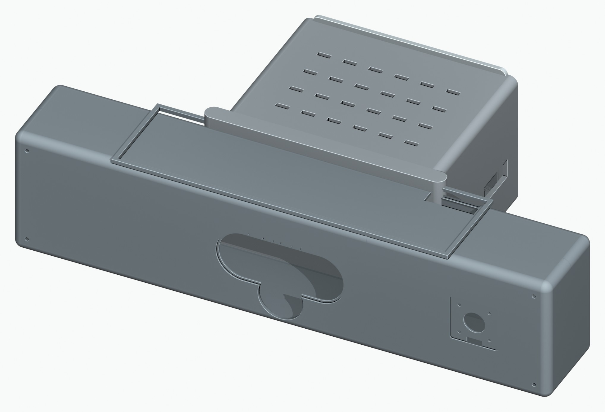
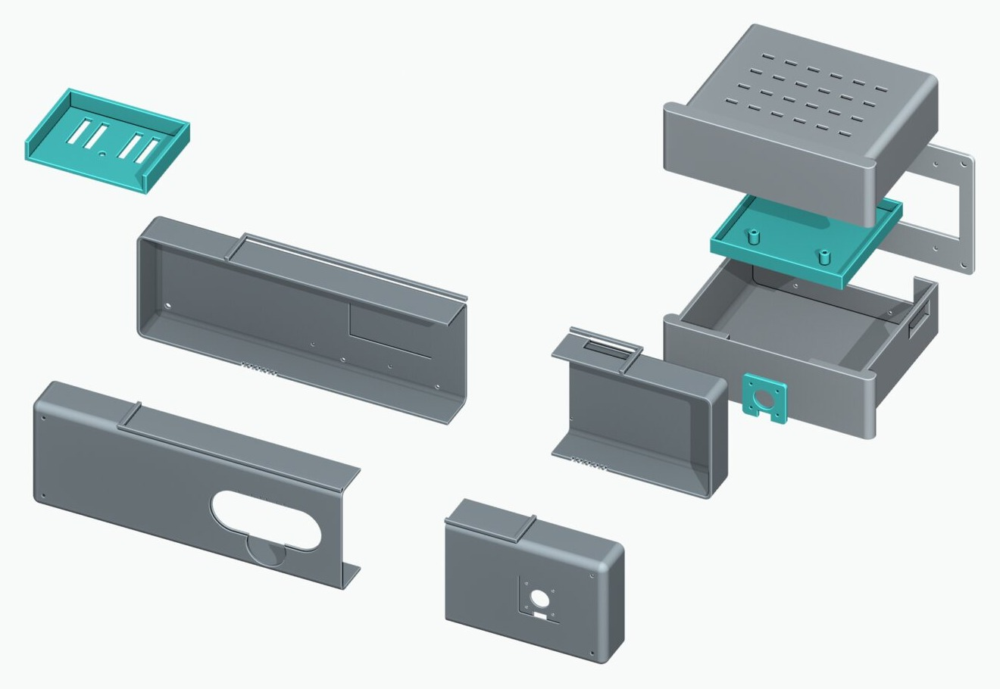

# LUME enclosure

Parametric OpenSCAD enclosure for LUME, a depth-camera stage visuals unit. One printable bar holds an Orbbec Femto Mega depth camera, an auxiliary camera, a mic array and a display. A rear pod holds the computer.



**Status:** designed in CAD and exported to STL. Joint coupons are designed for fit tests before the large prints. Not printed yet.

## Design

| | |
|---|---|
| Bar | 500 × 120 × 85 mm, four shells joined by tongue-and-groove plus two splice plates |
| Rear pod | 200 × 165 × 130 mm: vented lid, compute sled on standoffs, VESA plate |
| Walls | 3 mm |
| Printer | Every part fits a 420 mm bed, which is why the bar is split in four |
| Parts | 18 STL files in `stl/` |

Constraints the design works to:
- Depth camera front and center behind a clear sensor window.
- The computer needs airflow and service access, so it moved out of the bar into a vented rear pod.
- Joints are checked on small coupons at 0.1, 0.2 and 0.3 mm clearance before committing to the big shell prints.



## Parts

| STL | Part |
|---|---|
| `shell_front_L`, `shell_front_R` | Front shells: sensor window, camera port |
| `shell_rear_L`, `shell_rear_R` | Rear shells |
| `splice_plate` | Joins the left and right halves |
| `femto_mount` | Femto Mega depth-camera cradle |
| `arducam_mount` | Auxiliary camera mount |
| `mic_rail` | Mic array rail |
| `led_diffuser` | Status light diffuser |
| `cable_backbone` | Cable routing spine |
| `pod_top`, `pod_bottom` | Compute pod lid (vent slots) and base |
| `pod_compute_sled` | Compute sled on standoffs |
| `pod_vesa_plate` | VESA mounting plate |
| `coupon_tongues`, `coupon_grooves`, `coupon_splice_pegs`, `coupon_splice_pockets` | Joint test coupons |

## Source

All dimensions live in `cad/lume-config.scad`. Change a number there and every part follows.

| File | What it builds |
|---|---|
| `lume-config.scad` | Dimensions, component footprints, toggles |
| `lume-primitives.scad` | Shared helpers: rounded boxes, grilles, insert bosses, tongue and groove lips |
| `lume-components.scad` | Proxy volumes for the cameras, mic array, display and computer |
| `lume-shell.scad` | Bar shells and their split into printable sections |
| `lume-internals.scad` | Camera mounts, mic rail, diffuser, cable backbone, splice plate |
| `lume-pod.scad` | Rear compute pod |
| `lume-joinery-coupon.scad` | Joint coupons |
| `lume-main.scad`, `lume-tform-assembly.scad` | Assemblies and exploded views |
| `*-bolt*.scad` | Variant for the smaller Femto Bolt camera |

## Build

Needs [OpenSCAD](https://openscad.org). Export one part:

```bash
cd cad
openscad -o femto_mount.stl -D 'PART="femto_mount"' lume-internals.scad
openscad -o pod_top.stl -D 'PART="pod_top"' lume-pod.scad
openscad -o shell_front_L.stl -D 'PREVIEW="front_L"' lume-shell.scad
```

Or run the pipeline (`OPENSCAD` overrides the binary path):

```bash
cd cad
./render.sh preview   # PNG previews into cad/exports/
./render.sh stl       # STLs into cad/exports/
```

`cad/blender/` has the Blender scripts used for the renders in `images/`.

## License

MIT
